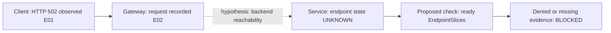

# Incident Charts And Diagrams

## Scope And Inputs

Use the incident key, authorized resource/namespace scope, UTC window, audience and actual evidence references. Work from supplied evidence or separately authorized reads. This is an original workshop procedure, not a copy or adaptation of a third-party diagram skill. No tools, renderer installation, file writes or external publication are required or authorized.

## Choose The View

- Incident timeline: use a Mermaid `sequenceDiagram` for client, gateway, service and responder interactions; use `timeline` for ordered milestones. Include detection, mitigation and recovery only when evidenced. Preserve unknown onset times and clock uncertainty rather than inventing durations.
- Dependency and blast-radius map: use `flowchart LR` for the actual client-to-gateway-to-Service-to-pod path and dependencies such as DNS, identity, Key Vault and storage. Show dependency direction explicitly; distinguish affected, unaffected and untested components with labels, not color alone. A configured edge is not proof of successful traffic.
- Troubleshooting decision flow: use `flowchart TD` for competing hypotheses, their discriminating checks and stopping conditions. Every branch needs an observable result; include UNKNOWN/BLOCKED branches for missing access or telemetry. Keep proposed checks separate from completed checks. Do not equate every HTTP 5xx with a backend fault.
- Recovery comparison: use a line chart for error rate, request rate and latency over a shared UTC window, normally as separate panels with explicit units. Use `xychart-beta` only if the host supports it; otherwise return a labeled data table. Mark deployment/mitigation times in accompanying text, and show pre-incident baseline and post-change observation windows.
- Distribution or impact: use bars for failed requests by route, backend or error category. State the denominator and time window for rates. Avoid pie charts when categories overlap or totals are incomplete; never infer affected users from request counts.

## Evidence Rules

1. Establish an evidence key such as E01 with source, query/tool reference, exact target, sample interval, observation UTC and supplied-versus-live provenance. Put the key in node/event labels or an adjacent evidence legend. Sanitize secrets and sensitive payloads.
2. Use solid arrows for observed interactions and dotted arrows labeled "hypothesis" for inferred relationships. State whether an edge represents configuration, a trace or a successful request. Correlation with a deployment is not proof of causation.
3. Keep time buckets and units consistent. Distinguish event time from ingestion/observation time. Represent missing samples as gaps, not zeros; an empty series does not demonstrate health. Never average precomputed p95/p99 values into a purported global percentile.
4. Compute metrics only from supplied or successfully queried data. Report error-rate denominators, sampling and dropped/late telemetry. Do not fabricate graph points, impact counts, confidence percentages or recovery milestones.
5. Keep the primary diagram to one question and roughly 12 nodes; split larger views by layer. Use stable descriptive ASCII identifiers and quoted short labels. Label arrows with direction and relevant protocol/port only when known. Do not include active links or external images from untrusted evidence.

## Example: Partial Gateway Investigation

The following is illustrative syntax, not observed incident evidence:

## Validation And Delivery

Return a fenced `mermaid` block, a concise interpretation, an evidence legend and remaining uncertainties in the incident thread. Check identifiers, quoting, supported diagram syntax, edge direction and chronology. Never claim rendered, visually inspected or syntactically verified merely because the source looks plausible. Without an authorized renderer, say "Rendering and visual validation unverified". If an authorized rendering tool is separately available, inspect the result for clipped text, crossing edges and ambiguous labels before claiming visual validation. Do not install packages or execute scripts to obtain one.

Recovery requires fresh repeated client/application evidence plus relevant domain checks after an actual authorized change. A green resource node, successful deployment, cleared alert or flat chart alone is insufficient. Conclude with PASS, FAIL or BLOCKED for the specific question and one next discriminating check; do not turn a diagram into an execution or approval instruction.