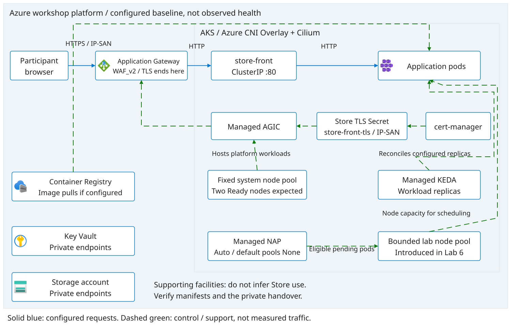
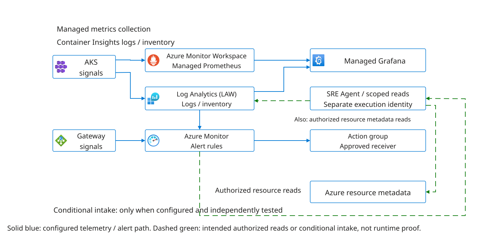

# Lab 1: Inspect The Pre-Provisioned Platform

Inspect the platform, application and observability architecture with Lab 2,
then confirm access across both labs. Use the facilitator's
[environment handover](../pre-provisioned-workshop.md). Infrastructure and the
Store are pre-provisioned; the SRE Agent resource is not. Create it in
[Lab 4](04-agent-configuration.md#1-create-your-team-sre-agent-resource).
Do not run Terraform, create resources or change role assignments in this lab.

## Architecture



[Editable platform diagram](../../diagrams/platform.drawio).
Trace the public request path separately from cluster management and scaling.
KEDA changes workload replicas; NAP provides bounded node capacity in Lab 6.
Neither is an instruction to start a scaling experiment during this walkthrough.



[Editable observability diagram](../../diagrams/observability.drawio).
Identify metrics, logs, dashboard and alert receiver separately. A resource's
existence does not prove fresh collection, notification delivery or agent intake;
Lab 3 owns those checks.

## Steps

1. Match the private handover to the approved tenant, subscription, resource
   groups, region and team. Record the provisioning/recovery owner, budget and
   STOP contact. In Azure portal, open **Directories + subscriptions**, select
   the approved scope, then **Resource groups** and the supplied group. Compare
   full resource IDs, not just display names; do not create replacement resources.
2. Open the supplied **Kubernetes service**. Read **Overview** for resource ID,
   region and API FQDN; inspect **Node pools** for system capacity and provisioner
   settings, and **Networking** for Overlay/Cilium and the gateway relationship.
   Compare the actual values with the readiness record below. If a blade or
   setting is unavailable to your identity, request dated facilitator evidence
   and label it as supplied rather than claiming your own successful read.
3. Open the supplied **Azure Monitor workspace**, **Log Analytics workspace**
   and **Azure Managed Grafana** resources. Record their IDs and the Grafana
   endpoint. Open the supplied dashboard, select the approved data sources and
   inspect the time range and latest sample timestamps without saving changes.
   Use the observability diagram to explain which source answers metrics versus
   logs questions. Missing access or stale samples are blockers for Lab 3.
4. Confirm access to `https://sre.azure.com` and record the approved subscription,
   resource group, resource name, region and creation/identity approval owner for
   [Lab 4](04-agent-configuration.md#1-create-your-team-sre-agent-resource).
   No agent resource or agent reads are required here. Labs 4-5 establish the
   resource, execution identity, configuration and runtime evidence. Do not
   broaden roles; leave untested automation paused.
5. Confirm portal and Grafana reads and access to the SRE Agent creation surface,
   then use the approved shell for the optional Kubernetes reads below.
   Record your assigned cluster name and context for later labs.
   Never copy Terraform state, deployment
   credentials or administrator kubeconfig into attendee storage.

## AKS Configuration And Readiness Record

Before proceeding, retain a sanitized record of actual settings and their source,
not an assumption that provisioning or a diagram proves readiness:

- Azure CNI Overlay, Cilium and the approved non-overlapping pod/service CIDRs.
   The scaling-enabled root selects pod CIDR `10.244.0.0/16`; review connected
   networks before accepting that value.
- Managed KEDA enabled, NAP provisioning mode `Auto`, default NAP pools `None`,
   and two Ready fixed system nodes, already enabled by the supplied infra release.
   `None` suppresses default pool creation; it does not delete existing pools.
   Inspect actual NodePools and AKSNodeClasses against the owner's inventory.
   Unexpected pools are an owner blocker before Lab 6, not permission to delete
   them. Lab 6's approved operator creates its bounded lab configuration.
- Inspect managed controller readiness and the CRDs
   `scaledobjects.keda.sh`, `triggerauthentications.keda.sh`,
   `nodepools.karpenter.sh`, `aksnodeclasses.karpenter.azure.com` and
   `nodeclaims.karpenter.sh`. Managed AKS NAP uses Karpenter APIs; do not install a
   second standalone Karpenter controller to satisfy this check. Missing APIs are
   a readiness/support blocker, not permission to install unrelated controllers.
- Approved region/SKU quota, cluster identity permissions, outbound registry
   access and network policy. A saved NodePool specification cannot guarantee
   available capacity or permission to create a VM.
- AGIC/Application Gateway identity and supplied backend-health evidence for
   the Store HTTPS Ingress. The Store frontend Services are ClusterIP; the old
   direct-HTTP LoadBalancer route is not this workshop baseline.
- Managed Prometheus collection/association, Log Analytics collection and Grafana
   identity/data-source access. Resource creation alone proves none of their data
   paths. Lab 3 verifies fresh samples and receivers.

For optional command-line checks, open the assigned AKS resource in the Azure
portal and select **Connect**. Follow the offered user-access instructions in
your approved shell; do not request administrator credentials. If access is
denied, use labeled facilitator evidence instead of widening roles.

Permission to retrieve a user kubeconfig is not Kubernetes API authorization.
Namespace reads, cluster-scoped nodes, CRDs, NodePools and AKSNodeClasses require
separately approved API permissions. Run each read only if authorized; otherwise
record BLOCKED and request dated owner-supplied evidence. Do not broaden roles.

List the available contexts:

```bash
kubectl config get-contexts
```

Replace `<workshop-context>` below with the context for your assigned cluster.
Check that its API server matches the **Connect** instructions or facilitator's
handover before continuing. These commands do not change your default context:

```bash
kubectl --context "<workshop-context>" config view --minify -o jsonpath='{.clusters[0].cluster.server}'
kubectl --context "<workshop-context>" get nodes
kubectl --context "<workshop-context>" get crd scaledobjects.keda.sh triggerauthentications.keda.sh nodepools.karpenter.sh aksnodeclasses.karpenter.azure.com nodeclaims.karpenter.sh
kubectl --context "<workshop-context>" get nodepools.karpenter.sh,aksnodeclasses.karpenter.azure.com
```

Keep the resulting source revision, target binding and settings with the Lab 1
evidence. Your participant reads do not prove the investigator agent has access.

## Suggested Prompts

Use these as optional discussion or later agent prompts, not as evidence of
runtime validation before Labs 4-5:

> Using only the supplied diagram and handover, explain the public request path,
> metrics/log destinations and separate participant, agent and recovery identities.
> Mark anything not verified as unknown; do not execute tools or change resources.

> Which supplied settings distinguish KEDA replica scaling from NAP node
> provisioning, and which live checks remain necessary before Lab 6?

Optional background: [operator preparation](../../facilitator/README.md) and
[SRE Agent architecture](../sre-agent-architecture.md). Deployment procedures
are owner references outside this attendee walkthrough, not steps to execute here.
See [AKS kubeconfig access](https://learn.microsoft.com/en-us/azure/aks/control-kubeconfig-access)
for the distinction between credential retrieval and API access.

## Checkpoint

PASS requires correct target binding, evidence of Ready nodes and expected
platform settings, monitoring access and access to the SRE Agent creation surface
with an approved creation owner and target settings for Lab 4. Distinguish your
observations from dated facilitator evidence. Record UTC, actor, revision, resource IDs, PASS/FAIL/BLOCKED
and next owner without including secrets. Configuration/runtime proof comes later.

## Troubleshooting And Safe Stop

For missing resources, access denials or unexpected settings, STOP the dependent
check and contact the provisioning owner. Do not deploy, rebuild, fetch admin
credentials or bypass policy. Label fallback evidence and unfinished work; never
replay a saved plan or claim an old rehearsal is today's observation.

Continue the shared walkthrough and access checks with [Lab 2](02-application.md).