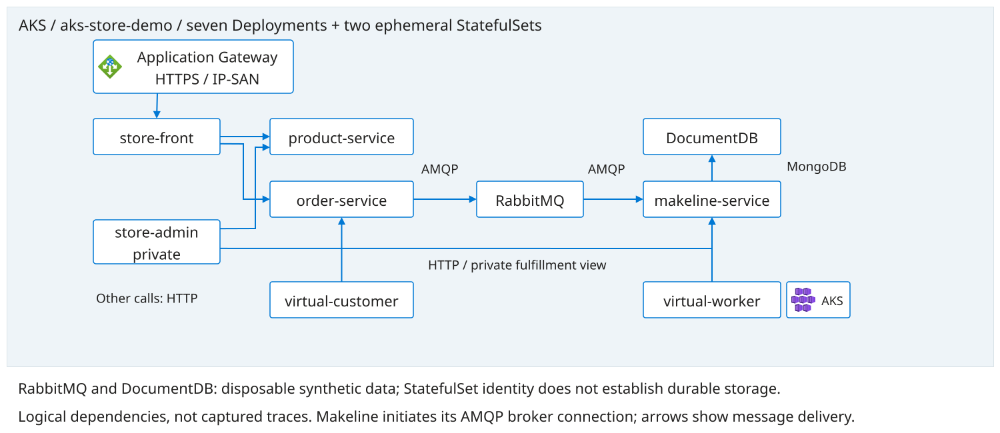

# Lab 2: Inspect The Pre-Provisioned Application

Continue the architecture walkthrough and access checks from Lab 1. Use the approved
[environment handover](../pre-provisioned-workshop.md), participant read access,
dedicated user kubeconfig and verified context/API. The Store is already deployed;
do not apply manifests, create namespaces or change networking. The application
uses synthetic data and disposable storage only.

## Architecture



[Editable application diagram](../../diagrams/application.drawio).
Trace product lookup separately from order submission, queue consumption and
fulfillment. These are configured dependencies, not captured traces: a working
catalog does not prove the broker, consumer or database is healthy.

## Steps

1. Match the handover's application revision, namespace and gateway public IP
   to the supplied environment. In Azure portal, open the assigned **Kubernetes
   service**, then **Kubernetes resources > Workloads**, filtering to
   `aks-store-demo`. Inspect desired/Ready counts and pod status for the seven
   Deployments and two StatefulSets. Portal Kubernetes views require separately
   authorized API access; use labeled facilitator evidence if unavailable.
2. Inspect **Services and ingresses** for the Store route and backends. Compare
   with the application diagram: `store-front`, `store-admin`, `product-service`,
   `order-service`, `makeline-service`, `virtual-customer`, `virtual-worker`,
   RabbitMQ and DocumentDB. The public route is Application Gateway HTTPS to
   `store-front` through a hostless Ingress; frontend Services remain ClusterIP.
   Do not infer a public IP from the `store-front` Service or deploy a replacement.
3. If approved, use these read-only commands to inspect the same resources.
   Replace `<workshop-context>` with the assigned context verified in
   [Lab 1](01-platform.md#aks-configuration-and-readiness-record):

   A user kubeconfig is connection information, not API authorization. These
   namespace reads require separate approved Kubernetes permissions. If denied,
   record BLOCKED and use dated owner-supplied evidence; do not request admin access.

   ```bash
   kubectl --context "<workshop-context>" -n aks-store-demo get deployments,statefulsets,pods
   kubectl --context "<workshop-context>" -n aks-store-demo get services,ingresses,endpointslices
   kubectl --context "<workshop-context>" -n aks-store-demo get statefulset documentdb -o yaml
   ```

4. During the shared access check, open `https://<gateway-public-ip>/` from your
   participant network using the verified public Store certificate supplied by
   the facilitator. Check certificate trust and matching IP SAN, products and
   product images. The IP-only route needs no DNS or hosts-file mapping. Do not
   bypass browser warnings or use `curl -k`. For an optional command-line check:

   ```bash
    : "${STORE_URL:?Set the approved https://gateway-public-ip/ URL}"
    : "${STORE_CA_CERT:?Set the verified public Store certificate path}"
    curl --fail --max-time 30 --cacert "$STORE_CA_CERT" --write-out '\nHTTP %{http_code}\n' "$STORE_URL"
   ```

   The certificate is public trust material, never the private key or PFX password.
5. Only with facilitator approval, place one synthetic order, which is an
   intentional application-data write. Verify queue consumption and successful
   makeline/database updates using approved telemetry or the supplied private
   administration surface. If this session is read-only, use labeled facilitator
   evidence and leave participant order validation BLOCKED. Do not expose admin
   services or scale synthetic clients. Record customer/worker replica baselines
   and access blockers in your evidence notes.

## Network And Data Checks From The Rehearsal

The supplied overlay includes the DocumentDB cold-start fix: 100m requested CPU,
500m CPU limit and up to 600s startup allowance. Inspect rendered resources and
the running revision; do not substitute the upstream 25m cap that caused the
observed startup loop. Replacing an unready database pod requires explicit
approval and inspection, not a generic retry command.

Check products and image requests in the browser as well as HTTP status. Compare
internal service response, Ready endpoints and supplied gateway backend health
when public HTTPS fails. Ask the network owner to inspect effective subnet
**and** NIC NSGs and gateway routing; attendees do not change these rules. An old
direct-HTTP LoadBalancer rehearsal is not evidence for the current HTTPS route.
Never expose RabbitMQ, DocumentDB, administration or arbitrary node ports to
repair storefront access. Recheck trust and routing after gateway IP changes.

The sample DocumentDB StatefulSet has no volumes or volumeClaimTemplates.
StatefulSet naming is not persistence: do not claim orders survive pod/cluster
recreation. This lab verifies a fresh synthetic order, not backup/restore or
historical data recovery. Keep persistence work outside this disposable lab
unless separately designed, approved and tested.

## Suggested Prompts

Optional discussion or later agent prompts; diagram answers are not live proof:

> Using only the supplied diagram and workload inventory, trace a product lookup
> and an order separately. Which observations would distinguish frontend,
> product API, RabbitMQ, makeline and DocumentDB failures? Do not execute changes.

> Explain why Ready pods, a successful homepage and a StatefulSet name do not
> prove order processing, public HTTPS health or durable storage. Mark missing
> evidence explicitly rather than assuming success.

Optional references: [pre-provisioned architecture and source revisions](../pre-provisioned-workshop.md)
and [operator preparation](../../facilitator/README.md). Deployment procedures remain
outside this attendee walkthrough.

## Checkpoint

PASS requires nine Ready workloads, populated service endpoints, public HTTPS
success and processed order evidence. A public homepage alone is insufficient.
Record the current customer/worker replica baseline for later comparison.

Record UTC, source/revision, PASS/FAIL/BLOCKED and next owner; distinguish your
reads and approved test order from supplied evidence. A previously healthy
rehearsal is not today's validation. Any optional nginx target is prepared by
the provisioning owner, not deployed by attendees during this walkthrough.

## Troubleshooting And Safe Stop

For certificate, access or readiness failures, STOP the dependent check and
contact the assigned owner. AGIC presence does not prove the public HTTPS path
works. Ask for gateway backend health and network evidence; do not broaden
Internet rules, reapply manifests or bypass certificate verification yourself.
For DocumentDB startup inspect resources/probes and revisions; do not blindly
delete database pods. Report FAIL/BLOCKED and preserve evidence.

Next: [Lab 3](03-observability.md).