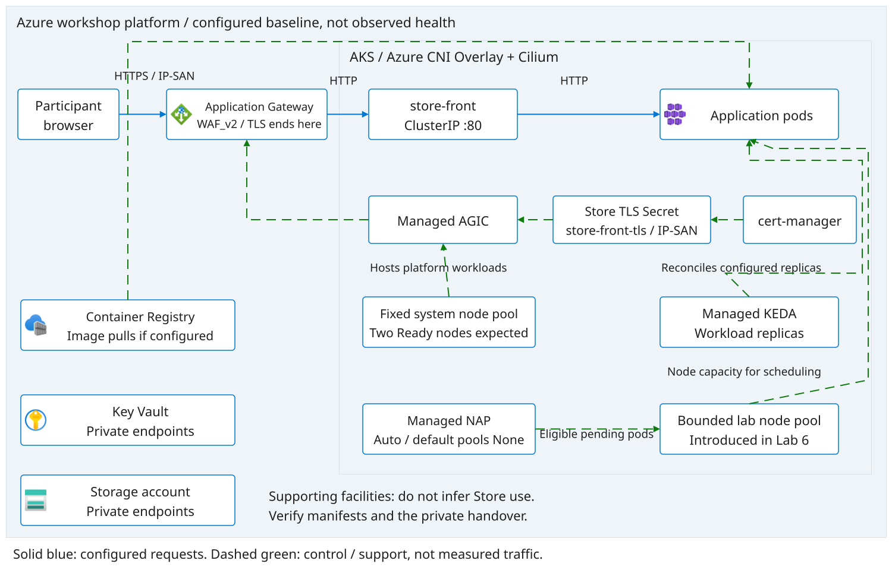
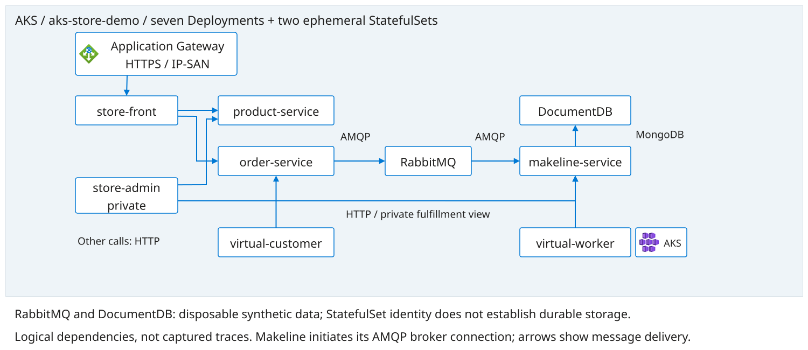

# Pre-Provisioned Platform And Application

This is the scheduled workshop route: the facilitator has already provisioned
the infrastructure and observability resources and deployed the Store application.
**The SRE Agent resource is not provided.** Participants create it in
[Lab 4: Agent Configuration](labs/04-agent-configuration.md) within the approved
scope, then configure it. Use this handover with attendee
[Lab 1](labs/01-platform.md) and [Lab 2](labs/02-application.md).
Operator-only deployment references are in [facilitator preparation](../facilitator/README.md).
The [agenda](../AGENDA.md) owns scheduling. The handover covers scope, costs,
platform/application/observability architecture, access and permissions.
This document does not authorize infrastructure changes. Continue with
[Lab 3: Observability](labs/03-observability.md), then
[Lab 4: Agent Configuration](labs/04-agent-configuration.md) and
[Lab 5: Agent Validation](labs/05-agent-validation.md).

## Environment Handover

The facilitator supplies the following privately before the walkthrough:

- Approved tenant, subscription, resource groups, region and team/environment.
- AKS name, full resource ID, expected context and exact API server; dedicated
  user kubeconfig or approved read-only access. Never share administrator credentials.
- Application Gateway IPv4 and verified public Store certificate trust material.
  The current IP-only route needs no DNS or hosts-file mapping. A hostname such
  as `sre.example.test` belongs to the optional bootstrap/nginx route. Never distribute
  the private key, PFX password, Terraform state or deployment credentials.
- Grafana URL, Prometheus data-source UID, Log Analytics workspace resource ID,
  dashboard links and approved alert receiver/test procedure.
- Approved SRE Agent creation subscription, resource group, agent name and
   region; authorized participant creation/configuration identity, identity owner,
   approved workload resource and namespace scope, permitted tools, recovery
   owner and STOP contact. No existing agent resource or Running agent is required
   for this handover. After creation in Lab 4, record the SRE Agent resource ID,
   URL and actual execution identity separately from the participant identity.
- Infrastructure revision, rendered application revision, known deviations,
  current synthetic-customer/worker replicas, cost owner and disposal deadline.

Use the supplied values rather than resource names from an earlier rehearsal.
Missing access means BLOCKED, not permission to deploy a replacement, fetch
administrator credentials or expand roles. Pre-provisioned does not imply the
monitoring has passed runtime validation. Agent creation/configuration belongs
to Lab 4; live agent and incident-automation validation belongs to Lab 5.

## Platform Architecture

The reference platform comes from the private
[infrastructure repository](https://github.com/mestredelpino/sre-agent-hackathon-infra).
Its AKS configuration uses Azure CNI Overlay with Cilium, a fixed system pool,
managed KEDA and Node Auto Provisioning (NAP). The workshop baseline expects two
Ready system nodes, NAP mode `Auto` and default NAP pools `None`: Lab 6 introduces
an explicitly bounded pool. Verify the actual supplied configuration rather
than assuming these settings from a diagram.



[Editable platform diagram](../diagrams/platform.drawio) |
[Diagram build and icon provenance](../diagrams/README.md).

Solid arrows show configured request paths; dashed arrows show management or
supporting relationships, not measured traffic. Registry, vault and storage are
platform facilities; the diagram does not claim the sample app uses all of them.
Image sources must be checked against the supplied manifests. KEDA changes
workload replicas; NAP provides node capacity. Neither proves successful order
processing, and neither is an instruction to start a scaling experiment now.

AGIC configures Application Gateway from the Store Ingress and Service endpoints;
the gateway forwards to backend pod IPs, not through the Service ClusterIP as an
extra proxy hop. Diagrams retain their logical Service relationships, not a
packet-level forwarding path. See [AGIC architecture](https://learn.microsoft.com/en-us/azure/application-gateway/ingress-controller-overview).
At infra revision
`33cf0ec1a9153f4b679d12da4f716c6f35133d5a`, the
[IP-only Store installer](https://github.com/mestredelpino/sre-agent-hackathon-infra/blob/33cf0ec1a9153f4b679d12da4f716c6f35133d5a/scripts/deploy-store-demo.sh)
creates a hostless `/` route to `store-front:80`, using `spec.tls.secretName`.
cert-manager issues an IP-SAN self-signed certificate into
`aks-store-demo/store-front-tls`. TLS terminates at the gateway; service/pod
traffic is HTTP. Both frontend Services remain ClusterIP. This Secret is separate
from Terraform's bootstrap `sre-lab-tls` PFX and optional `sre.example.test`
hostname. No HTTP redirect or ACME challenge is configured. The
historical direct-HTTP LoadBalancer route is not this workshop baseline.
Do not expose administration, RabbitMQ or DocumentDB publicly to solve an
access problem. An optional nginx baseline must not own the same host/path as
the Store Ingress at the same time.

## Application Architecture

The infra [Store overlay](https://github.com/mestredelpino/sre-agent-hackathon-infra/blob/33cf0ec1a9153f4b679d12da4f716c6f35133d5a/cluster/store-demo/kustomization.yaml)
pins [Azure-Samples/aks-store-demo](https://github.com/Azure-Samples/aks-store-demo/tree/1d61b202d1e6dc9a78389c15e4bb9d529e5499d3)
at `1d61b202d1e6dc9a78389c15e4bb9d529e5499d3`; the
infra repo's `cluster/store-demo` overlay and installer add cert-manager/IP-only
gateway routing. This historical pinned source baseline lacks the new tools;
before commands, the facilitator must confirm a reviewed infrastructure revision
that includes the required tools and record that revision in the handover.
Do not apply a retired workshop overlay as a second deployment.
A facilitator using the
[mestredelpino fork](https://github.com/mestredelpino/aks-store-demo) must record
its actual revision and differences: the fork's current default branch is not
automatically the deployed workshop revision.

Seven Deployments run `store-front`, `store-admin`, `product-service`,
`order-service`, `makeline-service`, `virtual-customer` and `virtual-worker`.
RabbitMQ and DocumentDB run as two StatefulSets in `aks-store-demo`.



[Editable application diagram](../diagrams/application.drawio).

These are configured logical interactions, not captured traces or measured
request rates. The queue-to-makeline arrow shows message delivery; the consumer
initiates its broker connection. Synthetic clients generate workload rather
than represent real customers. Trace a product lookup separately from an order:
an accessible catalog does not prove the broker, consumer or database works.

The supplied DocumentDB patch requests `100m` CPU, allows a `500m` CPU limit and
up to `600s` startup allowance. These are configuration values, not a latency
SLO. The pinned sample DocumentDB StatefulSet has no volumes or
`volumeClaimTemplates`: StatefulSet naming does not establish durable storage.
Use synthetic, disposable data and do not claim orders survive recreation.

## Observability And Investigation


[Editable observability diagram](../diagrams/observability.drawio).

Grafana visualizes existing sources; it does not prove collection is working.
The Graphviz topology can show deployment Ready/desired counts from `InsightsMetrics` and
configured dependencies, but missing StatefulSet target counts or request-rate
metrics remain unknown. Public HTTPS needs a separate client check: pod
readiness and service inventory do not prove gateway reachability.

The historical dashboard helper uses `ContainerLog` joined to `KubePodInventory`.
`ContainerLog` support retired September 30, 2026; the observability owner must
migrate collection and dependent queries/panels/rules to `ContainerLogV2` and
verify fresh results before handover. Mark legacy-dependent panels BLOCKED even
if transitional data appears. See [schema migration](https://learn.microsoft.com/en-us/azure/azure-monitor/containers/container-insights-logs-schema). Check data
freshness, source/workload scope, data-source permissions and log schema in
Lab 3. ACNS network dashboards are separate from application request traces.
Alert-rule existence, email delivery and agent incident intake are independent
checks, not interchangeable evidence.

For the agent itself, use the [SRE Agent logical architecture](sre-agent-architecture.md):
main chat versus custom triage, skills and knowledge, approved reads, conditional
incident triggers and separate execution/configuration/Grafana/operator identities.

Participants create the SRE Agent resource in Lab 4 within the approved scope,
separately from the supplied cluster Terraform. Its execution identity is not
the participant/operator identity. Labs 4-5 establish scoped tools, skills,
delegation and denial behavior; do not assume an operator's
successful `kubectl` command proves agent access. Leave untested response plans
and scheduled tasks paused and explicitly set Review on each. New response plans
are documented to start On: use proposed settings or owner-prepared Off plans,
not an assumed disabled-create option. Native Azure Monitor intake acknowledges
alerts and requires Monitoring Contributor; leave it BLOCKED under the strict
read-only investigator boundary. Manual supplied alert evidence is not automated
intake proof. Review is not a
universal write gate; enforce read-only workload access through identity and
tool policies. Do not inject faults before Lab 7.

## Walkthrough And Readiness

1. Match the handover's resource IDs and revisions to the diagrams. Identify the
   public request path, private administration path, queue and disposable data
   boundary. Record deviations before interpreting telemetry.
2. With the supplied access, verify context/API and inspect nodes, workload
   controllers, Services, Ingress and EndpointSlices. These checks are read-only:

   ```bash
   kubectl --context "<workshop-context>" get nodes
   kubectl --context "<workshop-context>" -n aks-store-demo get deployments,statefulsets,pods,services,ingresses,endpointslices
   ```

   Replace `<workshop-context>` with the assigned context verified using
   [Lab 1's connection instructions](labs/01-platform.md#aks-configuration-and-readiness-record).
   If cluster-level node reads are not granted, obtain the facilitator's dated
   evidence and label it as supplied, not a participant read. Do not fetch a
   different kubeconfig or bypass denied operations.
3. Use `https://<gateway-public-ip>/` and the verified public Store certificate.
  Check certificate trust, matching IP SAN and products/images. No hostname
  mapping is needed for this route. Gateway backend health
   is a separate operator-supplied check. Never use `curl -k` or bypass browser
   warnings. Follow [Lab 2's application validation](labs/02-application.md);
   deployment/apply procedures are operator-only references outside attendee labs.
4. With facilitator approval, place one synthetic order (a deliberate app-data
   write), then check its queue consumption and fulfillment/database evidence.
   If the app is read-only for this session, use labeled facilitator evidence
   and leave participant order validation BLOCKED. Do not scale clients or
   change workload resources in this walkthrough.
5. Open the supplied Grafana URL. Identify metrics/log sources and last
   sample times; compare Ready/desired replicas with controller output. Record
   customer/worker baselines and missing permissions for the next labs. Lab 3
   still owns its observability and alert-notification validation. Open the
   agent URL only after creating the resource in Lab 4; validate runtime access
   in Lab 5.

## Checkpoint And Continuation

Proceed when target binding is confirmed, the expected nine workload controllers
are present with Ready pods/endpoints, public HTTPS and a fresh processed order
have evidence, and monitoring access and approved agent-creation access are
available for the next labs. A running SRE Agent is not a checkpoint here;
participants create the resource in Lab 4 and validate its runtime in Lab 5.
Distinguish participant observations from facilitator-supplied evidence. Record
UTC time, source revision, expected/observed result, PASS/FAIL/BLOCKED and owner;
a previously green rehearsal does not satisfy today's gate.

For certificate, route, readiness, telemetry or access failures, stop the
dependent activity and ask the supplied owner. Do not reapply infrastructure,
delete pods, broaden NSGs or replay saved plans to bypass a blocked check. The
facilitator can provide a clearly labeled fallback, not an invented live result.

Continue to [Lab 3](labs/03-observability.md), then create/configure the agent in
[Lab 4](labs/04-agent-configuration.md) and validate it in
[Lab 5](labs/05-agent-validation.md). When later
labs refer to Lab 1's variables, use the facilitator's handover instead of
Terraform outputs/state. Operator-only tasks still require the assigned
operator; pre-provisioned is not a privilege grant. In
[Lab 8](labs/08-closeout.md), hand cleanup to the provisioning owner unless
explicitly authorized otherwise: do not destroy shared/prebuilt infrastructure.