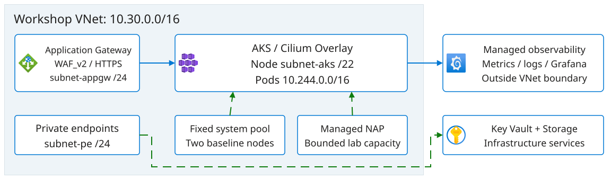
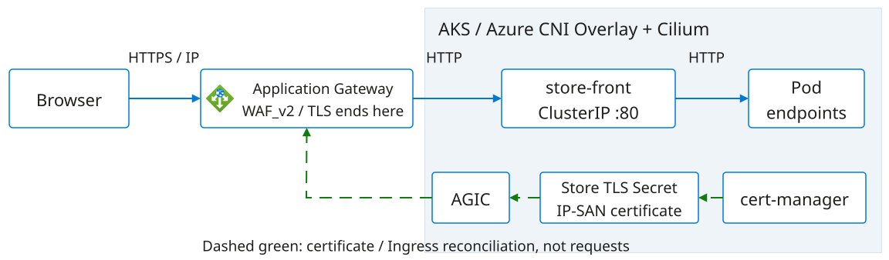
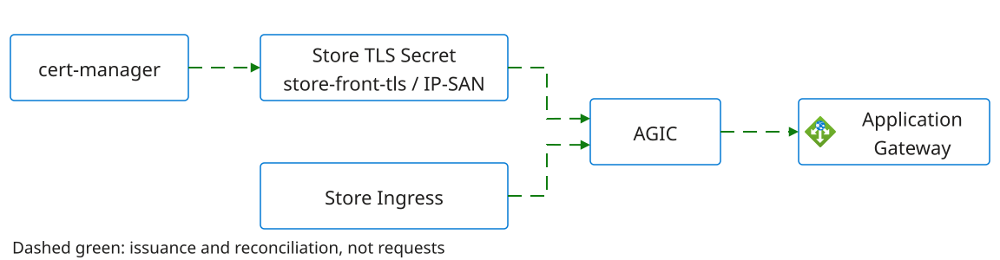
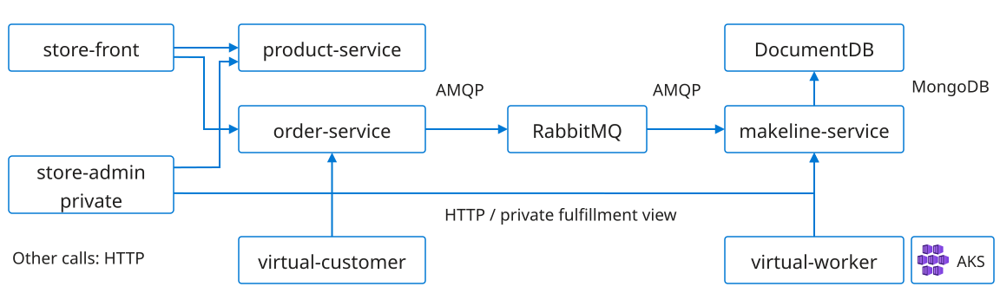
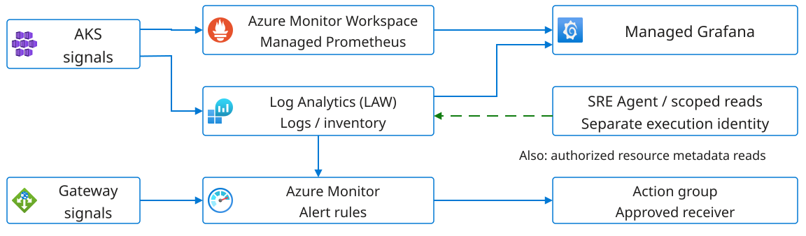

# Meet the system we'll investigate

<b>Already provisioned</b>
The facilitator supplies AKS, the Store application and an SRE Agent resource.

We'll explain how they fit together. You won't deploy infrastructure here.

<b>Your architecture walkthrough</b>
Trace the platform, application, observability and scaling boundaries.

Separate configured relationships from verified health and successful agent reads.

12:00-12:45: handover and architecture, including this 20-minute overview. 12:45-13:00: access and permissions confirmation.

References: <a href="../../exercises/pre-provisioned-workshop.md">supplied architecture</a> · <a href="../../AGENDA.md">two-day agenda</a>

<!--
TIME: 90 seconds.
Use this 20-minute overview within the combined 12:00-12:45 environment handover, scope, costs and platform/application/observability architecture block. Use the remaining 25 minutes for handover and a guided walkthrough across Labs 1-2, tracing the platform, application and observability with questions from the room. Keep access and permission confirmation for 12:45-13:00: Azure, AKS, Grafana and SRE Agent. Break follows at 13:00-13:15, then Lab 3 runs 13:15-14:00. The facilitator has provisioned all three components, but that doesn't prove the agent can read them. Ask which identity it will use. Resource IDs, revisions, gateway IP, certificate trust material, recovery owner and STOP contact come through the private handover. Keep credentials, Terraform state, private keys and secrets out of slides and agent knowledge. AKS and NAP presentations remain separate sessions.
-->

---

# The platform beneath the application

**Azure CNI Overlay + Cilium:** node subnet `10.30.4.0/22`, pod CIDR `10.244.0.0/16`, service CIDR `10.40.0.0/16`.

Declared workshop topology, not a live health check. The legacy delegated pod subnet is not the active Overlay pod address pool.

<!--
TIME: 90 seconds.
Trace the platform before the Store dependency graph. Application Gateway is in subnet-appgw, while AKS nodes use subnet-aks; NSGs and subnet associations can fail independently of application readiness. The current override selects Azure CNI Overlay and Cilium, with pod_subnet_id null: do not present the retained delegated subnet-pods resource as the active pod IP pool. Service addresses are virtual cluster addresses, not another Azure subnet. The fixed system pool has two nodes in the supplied baseline. Managed NAP uses Karpenter APIs and bounded lab pools, not a second standalone Karpenter installation. Private endpoints and private DNS support infrastructure data services; the Store's in-cluster RabbitMQ and DocumentDB are different dependencies. Azure Monitor Workspace, Log Analytics and Managed Grafana are managed services, not pods drawn inside this VNet. These are source declarations, not observed reachability, current capacity or collector health. Confirm environment-specific names and deviations from the private handover without displaying credentials, state or secrets.
-->

---

# What is in the resource group?

<table class="inventory">
<thead><tr><th>Resource family</th><th>What to recognize in Azure</th></tr></thead>
<tbody>
<tr><td>Compute and identity</td><td>AKS cluster, cluster managed identity and scoped role assignments</td></tr>
<tr><td>Network and entry</td><td>VNet, subnets, NSGs, static public IP, WAF policy and Application Gateway</td></tr>
<tr><td>Infrastructure data</td><td>ACR, Key Vault, Storage account, private endpoints and private DNS links</td></tr>
<tr><td>Collection and queries</td><td>Log Analytics, Azure Monitor Workspace, DCE, DCR and cluster associations</td></tr>
<tr><td>Operations</td><td>Managed Grafana, alert rules and action group; SRE Agent is supplied separately</td></tr>
</tbody>
</table>

Use actual IDs from the handover, not a guessed prefix. AKS also uses an Azure-managed node resource group for node infrastructure; a namespace is not an Azure resource group.

<!--
TIME: 90 seconds.
Open the conceptual Azure inventory in layers without treating every resource as an application dependency. The approved infra root looks up the existing workshop resource group; it does not automatically own the group's destruction. Cluster node infrastructure also lives in the AKS-managed node resource group, whose actual name must be read from approved inventory rather than guessed. Seven Store Deployments, two StatefulSets, Services, the Ingress and certificate objects are Kubernetes resources in aks-store-demo, not individual ARM resources in the workshop resource group. ACR is provisioned, but the pinned Store images reference external registries, so an ACR role failure does not automatically explain a Store image pull. Key Vault and Storage are infrastructure services, not the Store's RabbitMQ or DocumentDB. The SRE Agent resource is created separately from cluster Terraform and its location and permissions must be confirmed. DCE means data collection endpoint, DCR means data collection rule, and the association connects collection configuration to the cluster. An existing resource or role assignment is not proof of data flow or successful reads. Keep exact resource IDs and ownership in the private handover.
-->

---

# What runs in AKS

<b>Application workloads</b>
Seven Deployments: two frontends, three APIs and two synthetic clients.

RabbitMQ and DocumentDB are two StatefulSets in <code>aks-store-demo</code>.

<b>Platform services</b>
Azure CNI Overlay with Cilium provides the cluster network.

A fixed system pool supports platform workloads; managed KEDA and NAP have different scaling jobs.

ACR, Key Vault and storage are supporting platform facilities. Their presence does **not** mean every Store component uses them.

Sources: <a href="../../exercises/pre-provisioned-workshop.md#platform-architecture">platform baseline</a> · <a href="https://github.com/mestredelpino/sre-agent-hackathon-infra/blob/33cf0ec1a9153f4b679d12da4f716c6f35133d5a/cluster/store-demo/kustomization.yaml">pinned Store overlay</a>

<!--
TIME: 75 seconds.
Name the seven Deployments: store-front, store-admin, product-service, order-service, makeline-service, virtual-customer and virtual-worker. RabbitMQ and DocumentDB bring the controller count to nine. CNI Overlay and Cilium describe the network baseline, not evidence that a specific connection is permitted or healthy. The fixed system pool is expected to have two Ready nodes; this must be verified against the handover. The pinned sample revision is 1d61b202d1e6dc9a78389c15e4bb9d529e5499d3. The infrastructure installer adds the IP-only Store routing. The local scenario Terraform and older hostname overlay are references, not substitutes for the supplied private infrastructure revision. If a facilitator uses a fork, record the actual commit and differences. Do not infer Key Vault, storage or ACR dependencies without checking the deployed manifests.
-->

---

# The identities are part of the platform

<b>AKS and AGIC</b>
The cluster identity supports node networking. AGIC has separate gateway and subnet permissions to reconcile Ingress configuration.

<b>Grafana</b>
Its managed identity reads metrics and logs. A participant's Grafana role does not grant those backend reads to the agent.

<b>SRE Agent</b>
Its actual execution identity needs approved Azure, telemetry and namespace reads. Verify successful reads and denied writes.

<b>Provisioning and recovery</b>
Separate authorized operators own deployment and repairs. A proposed fix does not authorize an infrastructure write.

RBAC scope, effective identity and private network reachability are separate checks. Keep untested response plans paused in Review.

<!--
TIME: 90 seconds.
Use this slide to explain why an attendee can see a resource while an agent or Grafana cannot query it. The source declares a user-assigned AKS identity with subnet-scoped network rights. AGIC has its own identity, resource-group reads and gateway/subnet permissions; controller reconciliation is distinct from forwarding requests. Grafana's system-assigned identity has Monitoring Data Reader on the Azure Monitor Workspace and Monitoring Reader in the approved Azure scope, while Grafana Admin or Editor controls human dashboard administration. None of those grants automatically belong to the SRE Agent. Confirm the actual agent and connector execution identity, effective inheritance, Log Analytics access and Kubernetes namespace authorization; a normal-user kubeconfig can still be powerful. An authorization denial, an empty query and a private-endpoint timeout are not equivalent failures. Do not repair access by granting broad Contributor. Review applies to supported response actions, not every Kubernetes or external-tool write. Deployment and minimal recovery stay with separately authorized operators. No roles are created or changed by this presentation.
-->

---

# How a request reaches the Store

Open `https://<gateway-public-ip>/`. There is **no DNS mapping**; verify IP-SAN certificate trust rather than bypassing warnings.

Both frontend Services are ClusterIP; administration stays private. No HTTP redirect or ACME challenge is configured.

<!--
TIME: 120 seconds.
Follow the solid arrows from the browser. HTTPS terminates at Application Gateway; the configured route continues over HTTP through store-front ClusterIP on port 80 to the app pods. This is a logical route from configuration, not a packet capture or proof of an individual backend hop. Now follow the dashed arrows: cert-manager issues the self-signed IP-SAN certificate into aks-store-demo/store-front-tls, and AGIC uses that namespaced Secret when reconciling the Store Ingress into gateway configuration. AGIC isn't an inline proxy. This is not the optional bootstrap certificate or hostname route. Don't fetch private material or display Secret contents. Ask where TLS terminates. Later, verify public access with a trusted client and operator-supplied backend health. If trust or access is missing, record BLOCKED; don't use curl -k or expose private services. No live operation is performed here.
-->

---

# Who keeps the gateway configured?

**AGIC is not an inline proxy.** It reconciles the gateway from Kubernetes configuration.

The namespaced Store Secret is separate from Terraform's bootstrap <code>sre-lab-tls</code> PFX and optional hostname route.

Source: <a href="https://github.com/mestredelpino/sre-agent-hackathon-infra/blob/33cf0ec1a9153f4b679d12da4f716c6f35133d5a/scripts/deploy-store-demo.sh">IP-only Store installer at reference revision</a>

<!--
TIME: 90 seconds.
Return to the distinction between requests and management. cert-manager issues the self-signed IP-SAN certificate into aks-store-demo/store-front-tls. The Ingress references that Secret through spec.tls.secretName. AGIC consumes this configuration and reconciles Application Gateway; it does not forward every browser request. Terraform's bootstrap sre-lab-tls PFX is a separate certificate path, not the Store Secret. The optional sre.example.test hostname and nginx route are not this IP-only entry and must not compete for the same host and path. If the certificate is wrong, look at issuance, Ingress references and gateway reconciliation as separate boundaries. Never display Secret contents, private keys or PFX passwords to explain this slide. Ask whether restarting an application API would logically fix a mismatched public certificate; the failure is earlier in the path.
-->

---

# Browsing products and processing orders

**RabbitMQ and DocumentDB are ephemeral.** Use disposable synthetic data only. A StatefulSet alone doesn't make storage durable.

Configured logical dependencies, not distributed traces or measured dependency edges. Synthetic clients generate workload.

<!--
TIME: 120 seconds.
Start with a catalog lookup, then follow an order through publication, consumption and saved order state. Ask whether a working product page proves an order was fulfilled. It doesn't. The RabbitMQ-to-makeline arrow shows message delivery; makeline initiates the broker connection. DocumentDB uses a MongoDB-compatible protocol. The private store-admin calls product-service and makeline. There are seven Deployments and two StatefulSets, RabbitMQ and DocumentDB. Both data services are ephemeral in this baseline; the pinned DocumentDB manifest has no volumes or volumeClaimTemplates. Recreating them must not be presented as preserving orders. Creating a synthetic order is an app-data write requiring later facilitator approval, so don't do it during this introduction. The arrows come from configuration, not measured traffic. Confirm supplied revisions and any deviations during the explanation.
-->

---

# The other clients, and the data they leave behind

<b>Not every request is a person</b>
<code>virtual-customer</code> sends synthetic orders to order-service.

<code>virtual-worker</code> calls makeline over HTTP for synthetic fulfillment.

Private <code>store-admin</code> reads catalog and fulfillment APIs.

<b>This is disposable application data</b>
RabbitMQ and DocumentDB are ephemeral in this baseline.

A StatefulSet gives stable identity, not a durability guarantee.

Don't assume orders survive recreation.

A slow-starting database and a lost order are different problems. Check startup, storage and application evidence separately.

Sources: <a href="https://github.com/mestredelpino/sre-agent-hackathon-infra/blob/33cf0ec1a9153f4b679d12da4f716c6f35133d5a/cluster/store-demo/kustomization.yaml">DocumentDB resource/probe patch</a> · <a href="../../exercises/pre-provisioned-workshop.md#application-architecture">data and client boundaries</a>

<!--
TIME: 75 seconds.
Make the synthetic clients explicit so participants do not attribute every request to somebody in the room. Their actual replica counts come from the handover; do not infer rates from replicas. Store-admin calls product-service for the catalog and makeline for fulfillment, but it is not publicly exposed. The pinned DocumentDB StatefulSet has no volumes or volumeClaimTemplates; the baseline does not promise durable orders. RabbitMQ is also ephemeral. The local DocumentDB patch requests 100m CPU, limits CPU to 500m and allows up to 600 seconds for startup. Those are configuration values, not an observed latency or a service-level objective. A readiness problem may explain unavailable consumers without proving data loss. Ask what evidence would distinguish those two hypotheses. Do not delete, restart or expose any of these services as part of this explanation.
-->

---

# Where the metrics, logs and alerts go

**An alert reaching a receiver doesn't prove it reached the agent.** Alert-to-agent routing must be configured and tested separately.

Check timestamps, workload scope and log schema. A dashboard or a Running agent isn't proof of a successful read.

<!--
TIME: 120 seconds.
Point out the two workspaces. Managed Prometheus metrics go to Azure Monitor Workspace; Container Insights logs and inventory go to Log Analytics. Grafana displays them, but doesn't collect them or prove they're fresh. These are the supplied gateway and Log Analytics alert paths, not every Azure Monitor option. Test the action group, receiver delivery and native agent incident intake independently; we haven't drawn native intake as an established connection. Dashed green shows an intended authorized read, not one we've demonstrated. Your successful read doesn't prove the agent's identity can do it. In Labs 3-5, check timestamps, source, workload scope, actual query returns, skill use, specialist return and denied operations. Check ContainerLog versus ContainerLogV2. Neither a service map nor an ACNS network dashboard establishes application traces. Leave untested response plans paused and in Review; Review is not a universal write gate.
-->

---

# Alerts declared in the infra

<table class="inventory">
<thead><tr><th>Alert resource</th><th>Condition / lookback</th><th>Evaluation</th></tr></thead>
<tbody>
<tr><td><code>alert-appgw-unhealthy-host</code></td><td>Unhealthy backends &gt; 0 / 5m</td><td>Every 1m</td></tr>
<tr><td><code>alert-aks-node-cpu-high</code></td><td>Average node CPU &gt; 85% / 15m</td><td>Every 5m</td></tr>
<tr><td><code>alert-aks-node-not-ready</code></td><td>Not Ready node inventory / 10m</td><td>Every 5m</td></tr>
<tr><td><code>alert-aks-pod-restarts</code></td><td>Restart-count increase &gt; 5 / 15m</td><td>Every 5m</td></tr>
<tr><td><code>alert-aks-image-pull-failures</code></td><td>Pull-failure events / 15m</td><td>Every 5m</td></tr>
<tr><td><code>alert-kv-failures</code></td><td>Failed requests &gt; 3 / 5m</td><td>Every 5m</td></tr>
<tr><td><code>alert-storage-auth-failures</code></td><td>Authorization failures &gt; 3 / 10m</td><td>Every 5m</td></tr>
</tbody>
</table>

Metric alerts target AKS/gateway; log alerts query Log Analytics. Action group <code>ag-&lt;prefix&gt;-aks</code> has an optional email receiver: configured rules do not prove delivery or agent intake.

<!--
TIME: 90 seconds.
This inventory describes the rules in the inspected infra monitoring.tf, not a live list of enabled rules or delivered incidents. Distinguish metric rules scoped to the gateway/cluster from log-search rules whose Azure scope is the Log Analytics workspace and whose KQL must select the intended cluster or service. The lookback is the range of data evaluated; the evaluation interval is how often the rule runs, and neither guarantees immediate detection after injection. Restarts use a counter increase over the window in the current source, not a lifetime count. The image rule checks KubeEvents reasons and pull-related messages. Key Vault and Storage auth failures come from their diagnostics, not the Store database. StorageBlobLogs and legacy versus resource-specific gateway tables must actually be populated. skip_query_validation means deployment can succeed before those queries work. The action group only gets an email receiver when alert_email is configured; an empty receiver is not notification delivery. Test collection, evaluation, receiver delivery and native SRE Agent intake independently, with timestamps. The homepage, queue, KEDA and NAP are not comprehensively covered by this baseline list. Optional additional rules or probes require their own approved configuration and runtime proof; do not imply distributed tracing or order-completion monitoring is installed.
-->

---

# More pods, or more nodes?

<b>KEDA changes replica counts</b>
A configured scaler signal changes how many pods the workload wants.

Compare desired and Ready replicas with the signal that triggered scaling.

<b>NAP provisions nodes</b>
Eligible pending pods can trigger provisioning within approved NodePool constraints.

Watch scheduling and node capacity, then check scale-in later.

**Fixed system pool** hosts platform workloads. The supplied baseline expects NAP `Auto`, default NAP pools `None`; Lab 6 introduces a bounded pool.

Did orders actually succeed? Check application health too, then stop the bounded synthetic load.

<!--
TIME: 75 seconds.
Ask: if existing nodes have capacity, must an increase in replicas create a node? No. Conversely, node provisioning does not prove a queue is draining or a customer order succeeded. The supplied baseline expects two Ready system nodes; verify the handover rather than treating this slide as observation. NAP is managed AKS Node Auto Provisioning using Karpenter APIs. Do not create pools or start load now; the Day 2 NAP presentation and Lab 6 own bounded tests, budgets and stop conditions. Record pod scale-out, node provisioning and scale-in as separate observations. After the bounded scaling test restore customer/worker/queue baselines, remove probe leftovers and verify no stray NAP nodes with the approved owner. No commands or cloud changes are executed here.
-->

---

# Where would you look first?

| What we see | The next boundary to inspect |
| --- | --- |
| Browser cannot open the Store | IP-SAN trust, gateway route and backend health |
| Products load; orders don't complete | order-service, RabbitMQ, makeline and DocumentDB |
| Desired pods rise; Ready pods don't | Pod events, scheduling and bounded node capacity |
| Dashboard is empty | Collection, timestamps, scope, schema and permissions |
| Agent cannot investigate | Its own identity, tool scope and actual failed read |

Next, match the supplied Azure, AKS, Grafana and SRE Agent access to this picture. Keep anything unverified visible.

Source: <a href="../../exercises/pre-provisioned-workshop.md#walkthrough-and-readiness">handover and access checks</a>

<!--
TIME: 75 seconds.
Invite the room to choose one symptom and explain why they would start at that boundary. These are starting hypotheses, not diagnoses or repair recipes. A certificate failure is not proof that the app pods are unhealthy; an accepted order is not proof of consumption; a desired replica count is not capacity; an empty panel is not proof of no traffic; an agent permission failure is not proof that telemetry is absent. Public HTTPS and processed-order validation require their own evidence beyond pod readiness. Transition to the supplied access checks without running commands or making app-data writes now. Bind the real resource IDs, API server and source revisions from the private handover, distinguish participant observations from dated facilitator evidence, and record blocked access with its owner. Missing access does not authorize fetching admin credentials, deploying replacements or expanding permissions.
-->