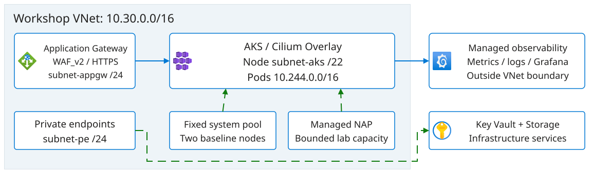
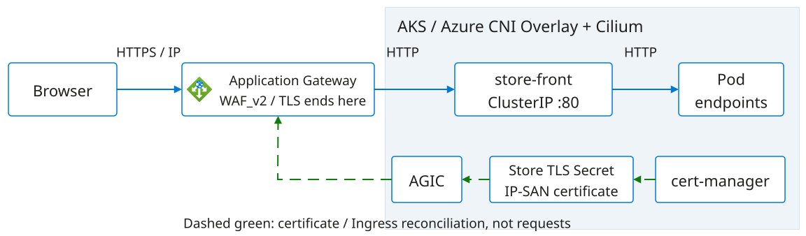
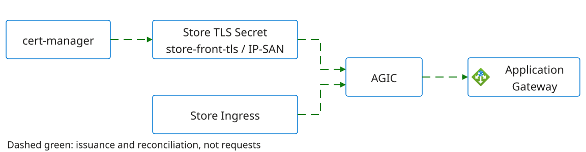
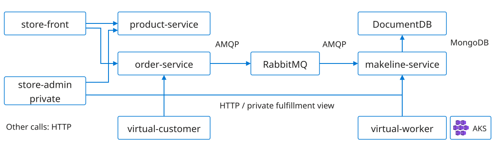
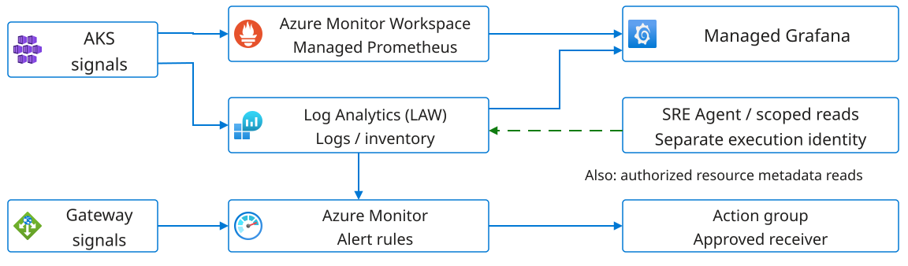

# Meet the system we'll investigate

<b>The supplied environment</b>
AKS hosts the Store application alongside managed networking and monitoring.

Participants create their SRE Agent in Lab 4 with separate connections.

<b>Platform and application boundaries</b>
Request paths, dependencies and identities explain how the system fits together.

Configured relationships differ from verified health and successful agent reads.

Labs 1-2 establish the system model behind later investigations: where requests flow, which dependencies matter and what each boundary can explain.

References: <a href="../../exercises/pre-provisioned-workshop.md">supplied architecture</a> · <a href="../../AGENDA.md">two-day agenda</a>

<!--
TIME: 90 seconds.
This 20-minute overview sits within the 12:00-12:45 handover and architecture block; access confirmation follows at 12:45-13:00. Labs 1-2 establish a shared model of the Azure platform and Store application before telemetry or agent behavior is interpreted. The environment is already provisioned, but resource existence is different from application health and from an agent's ability to read it. Request paths explain user-visible symptoms, control paths explain configuration changes, and identity boundaries explain differing access. Later labs build on these distinctions rather than treating every failure as an application fault. The private handover supplies the environment-specific IDs and revisions; the diagrams describe the declared baseline rather than current observations.
-->

---

# The platform beneath the application

**Azure CNI Overlay + Cilium:** node subnet `10.30.4.0/22`, pod CIDR `10.244.0.0/16`, service CIDR `10.40.0.0/16`.

Declared workshop topology, not a live health check. The legacy delegated pod subnet is not the active Overlay pod address pool.

<!--
TIME: 90 seconds.
Application Gateway is in subnet-appgw, while AKS nodes use subnet-aks; NSGs and subnet associations can affect reachability independently of application readiness. The override selects Azure CNI Overlay and Cilium, with pod_subnet_id null. The retained delegated subnet-pods resource is not the active pod IP pool. Service addresses are virtual cluster addresses, not another Azure subnet. The fixed system pool has two nodes in the supplied baseline. Managed NAP uses Karpenter APIs and bounded lab pools, not a second standalone installation. Private endpoints and DNS support infrastructure data services; in-cluster RabbitMQ and DocumentDB are different dependencies. Azure Monitor Workspace, Log Analytics and Managed Grafana are managed services outside this VNet boundary. These source declarations explain topology, not observed reachability, current capacity or collector health.
-->

---

# What is in the resource group?

<table class="inventory">
<thead><tr><th>Resource family</th><th>What to recognize in Azure</th></tr></thead>
<tbody>
<tr><td>Compute and identity</td><td>AKS cluster, cluster managed identity and scoped role assignments</td></tr>
<tr><td>Network and entry</td><td>VNet, subnets, NSGs, static public IP, WAF policy and Application Gateway</td></tr>
<tr><td>Infrastructure data</td><td>ACR, Key Vault, Storage account, private endpoints and private DNS links</td></tr>
<tr><td>Collection and queries</td><td>Log Analytics, Azure Monitor Workspace, DCE, DCR and cluster associations</td></tr>
<tr><td>Operations</td><td>Managed Grafana, alert rules and action group; participants create SRE Agent in Lab 4</td></tr>
</tbody>
</table>

The handover identifies the supplied resources. AKS also uses an Azure-managed node resource group for node infrastructure; a namespace is not an Azure resource group.

<!--
TIME: 90 seconds.
The Azure inventory groups resources by responsibility, not by whether every Store request uses them. The approved infra root looks up the existing workshop resource group; it does not automatically own the group's destruction. Node infrastructure also lives in an AKS-managed node resource group. Seven Store Deployments, two StatefulSets, Services, Ingress and certificate objects are Kubernetes resources in aks-store-demo, not individual ARM resources in the workshop resource group. ACR exists, but pinned Store images reference external registries. Key Vault and Storage are infrastructure services, not RabbitMQ or DocumentDB. Participants create SRE Agent in Lab 4, separately from cluster Terraform. DCE means data collection endpoint; DCR means data collection rule. Their association connects collection configuration to the cluster. Resource existence and role assignments describe intended capabilities, not proven data flow.
-->

---

# What runs in AKS

<b>Application workloads</b>
Seven Deployments: two frontends, three APIs and two synthetic clients.

RabbitMQ and DocumentDB are two StatefulSets in <code>aks-store-demo</code>.

<b>Platform services</b>
Azure CNI Overlay with Cilium provides the cluster network.

A fixed system pool supports platform workloads; managed KEDA and NAP have different scaling jobs.

ACR, Key Vault and storage are supporting platform facilities. Their presence does **not** mean every Store component uses them.

Sources: <a href="../../exercises/pre-provisioned-workshop.md#platform-architecture">platform baseline</a> · <a href="https://github.com/mestredelpino/sre-agent-hackathon-infra/blob/33cf0ec1a9153f4b679d12da4f716c6f35133d5a/cluster/store-demo/kustomization.yaml">pinned Store overlay</a>

<!--
TIME: 75 seconds.
The seven Deployments are store-front, store-admin, product-service, order-service, makeline-service, virtual-customer and virtual-worker. RabbitMQ and DocumentDB bring the controller count to nine. CNI Overlay and Cilium describe the network baseline, not evidence that a specific connection is permitted or healthy. The fixed system pool is expected to have two Ready nodes. The pinned sample revision is 1d61b202d1e6dc9a78389c15e4bb9d529e5499d3, and the infrastructure installer adds IP-only Store routing. Older hostname overlays are different configurations, not substitutes for the supplied private infrastructure revision. Dependencies follow the deployed manifests rather than the presence of Key Vault, storage or ACR in the wider platform.
-->

---

# The identities are part of the platform

<b>AKS and AGIC</b>
The cluster identity supports node networking. AGIC has separate gateway and subnet permissions to reconcile Ingress configuration.

<b>Grafana</b>
Its managed identity reads metrics and logs. A participant's Grafana role does not grant those backend reads to the agent.

<b>SRE Agent</b>
Its actual execution identity needs approved Azure, telemetry and namespace reads. Read results and enforced denials demonstrate effective access.

<b>Provisioning and recovery</b>
Separate authorized operators own deployment and repairs. A proposed fix does not authorize an infrastructure write.

Identity, RBAC and network access are independent. Review is not a universal tool gate.

<!--
TIME: 90 seconds.
An attendee can see a resource while an agent or Grafana cannot query it because their execution identities differ. AKS has a user-assigned identity with subnet-scoped network rights. AGIC has separate resource-group reads and gateway/subnet permissions for reconciliation. Grafana's system-assigned identity has Monitoring Data Reader on Azure Monitor Workspace and Monitoring Reader in the approved Azure scope; Grafana Admin or Editor instead controls human dashboard administration. None of those grants automatically belongs to SRE Agent. Effective inheritance, Log Analytics access, namespace authorization and network reachability all shape a read. Authorization denial, an empty result and a private-endpoint timeout are different observations. Review applies to supported response actions rather than every external operation. Provisioning and recovery belong to separate authorized identities.
-->

---

# How a request reaches the Store

The Store entry is `https://<gateway-public-ip>/`. There is **no DNS mapping**; certificate trust depends on its IP-SAN identity.

ClusterIP Services identify backend pods; the gateway forwards directly to pod IPs. Administration stays private.

<!--
TIME: 120 seconds.
The solid arrows describe logical Service relationships, not a packet capture or a ClusterIP proxy hop. HTTPS terminates at Application Gateway; AGIC derives backend endpoints from Ingress and Service configuration, and the gateway forwards HTTP directly to backend pod IPs. The dashed arrows describe control: cert-manager issues the self-signed IP-SAN certificate into aks-store-demo/store-front-tls, and AGIC uses that namespaced Secret while reconciling Store Ingress into gateway configuration. AGIC is not an inline proxy. No HTTP redirect or ACME challenge is configured. The optional bootstrap certificate and hostname route are separate paths. Certificate identity, client trust, gateway backend health and application readiness can explain different failures even when the visible symptom is the same unavailable page. Product reference: https://learn.microsoft.com/en-us/azure/application-gateway/ingress-controller-overview.
-->

---

# Who keeps the gateway configured?

**AGIC is not an inline proxy.** It reconciles the gateway from Kubernetes configuration.

The namespaced Store Secret is separate from Terraform's bootstrap <code>sre-lab-tls</code> PFX and optional hostname route.

Source: <a href="https://github.com/mestredelpino/sre-agent-hackathon-infra/blob/33cf0ec1a9153f4b679d12da4f716c6f35133d5a/scripts/deploy-store-demo.sh">IP-only Store installer at reference revision</a>

<!--
TIME: 90 seconds.
Requests and management follow different paths. cert-manager issues the self-signed IP-SAN certificate into aks-store-demo/store-front-tls. The Ingress references that Secret through spec.tls.secretName. AGIC consumes the configuration and reconciles Application Gateway rather than forwarding browser requests. Terraform's bootstrap sre-lab-tls PFX is a separate certificate path, not the Store Secret. The optional sre.example.test hostname and nginx route are not this IP-only entry. Certificate issuance, Ingress references and gateway reconciliation are distinct boundaries. A mismatch in the public certificate can occur before any application API is involved, which explains why healthy pods do not settle every question about public access.
-->

---

# Browsing products and processing orders

**RabbitMQ and DocumentDB are ephemeral.** The baseline holds disposable synthetic data. A StatefulSet alone doesn't make storage durable.

Configured logical dependencies, not distributed traces or measured dependency edges. Synthetic clients generate workload.

<!--
TIME: 120 seconds.
A catalog lookup and a completed order exercise different dependencies. The order path includes publication, consumption and saved order state, so a working product page does not prove fulfillment. The RabbitMQ-to-makeline arrow represents message delivery; makeline initiates the broker connection. DocumentDB uses a MongoDB-compatible protocol. Private store-admin calls product-service and makeline. There are seven Deployments and two StatefulSets, RabbitMQ and DocumentDB. Both data services are ephemeral; the pinned DocumentDB manifest has no volumes or volumeClaimTemplates. Recreation therefore does not promise preserved orders. These arrows describe configured dependencies rather than measured traffic or distributed traces, making them a model for interpreting later evidence rather than proof of a successful transaction.
-->

---

# The other clients, and the data they leave behind

<b>Not every request is a person</b>
<code>virtual-customer</code> sends synthetic orders to order-service.

<code>virtual-worker</code> calls makeline over HTTP for synthetic fulfillment.

Private <code>store-admin</code> reads catalog and fulfillment APIs.

<b>This is disposable application data</b>
RabbitMQ and DocumentDB are ephemeral in this baseline.

A StatefulSet gives stable identity, not a durability guarantee.

Recreation can lose stored orders.

A slow-starting database and a lost order are different problems, distinguished by startup, storage and application evidence.

Sources: <a href="https://github.com/mestredelpino/sre-agent-hackathon-infra/blob/33cf0ec1a9153f4b679d12da4f716c6f35133d5a/cluster/store-demo/kustomization.yaml">DocumentDB resource/probe patch</a> · <a href="../../exercises/pre-provisioned-workshop.md#application-architecture">data and client boundaries</a>

<!--
TIME: 75 seconds.
Synthetic clients account for requests that do not originate from people in the room. Replica counts alone do not establish their request rates. Private store-admin calls product-service for the catalog and makeline for fulfillment. The DocumentDB StatefulSet has no volumes or volumeClaimTemplates, and RabbitMQ is also ephemeral. The local DocumentDB patch requests 100m CPU, limits CPU to 500m and allows up to 600 seconds for startup. Those values describe configuration, not observed latency or a service-level objective. A readiness problem can explain unavailable consumers without proving data loss. Startup evidence and storage evidence answer different questions, even when both appear to explain a missing order.
-->

---

# Where the metrics, logs and alerts go

**An alert reaching a receiver doesn't prove it reached the agent.** Alert-to-agent routing must be configured and tested separately.

Time, scope and schema give evidence context. A dashboard or Running agent does not prove a read.

<!--
TIME: 120 seconds.
Managed Prometheus metrics go to Azure Monitor Workspace; Container Insights logs and inventory go to Log Analytics. Grafana displays those sources but does not collect them or establish freshness. The diagram shows supplied gateway and Log Analytics alert paths rather than every Azure Monitor option. Action-group delivery and native agent intake are independent capabilities. Native Azure Monitor intake acknowledges alerts and needs Monitoring Contributor, so it remains BLOCKED under the workshop's strict read-only boundary. Dashed green describes an intended authorized read, not a demonstrated one. A participant's successful read does not establish access under the agent identity. Lab 3 establishes the human baseline before agent creation. ContainerLog support retired September 30, 2026; owner migration to ContainerLogV2 and fresh-query validation are required. Neither a service map nor an ACNS network dashboard establishes application traces. Review is not a universal write gate.
-->

---

# Alerts declared in the infra

<table class="inventory">
<thead><tr><th>Alert resource</th><th>Condition / lookback</th><th>Evaluation</th></tr></thead>
<tbody>
<tr><td><code>alert-appgw-unhealthy-host</code></td><td>Unhealthy backends &gt; 0 / 5m</td><td>Every 1m</td></tr>
<tr><td><code>alert-aks-node-cpu-high</code></td><td>Average node CPU &gt; 85% / 15m</td><td>Every 5m</td></tr>
<tr><td><code>alert-aks-node-not-ready</code></td><td>Not Ready node inventory / 10m</td><td>Every 5m</td></tr>
<tr><td><code>alert-aks-pod-restarts</code></td><td>Restart-count increase &gt; 5 / 15m</td><td>Every 5m</td></tr>
<tr><td><code>alert-aks-image-pull-failures</code></td><td>Pull-failure events / 15m</td><td>Every 5m</td></tr>
<tr><td><code>alert-kv-failures</code></td><td>Failed requests &gt; 3 / 5m</td><td>Every 5m</td></tr>
<tr><td><code>alert-storage-auth-failures</code></td><td>Authorization failures &gt; 3 / 10m</td><td>Every 5m</td></tr>
</tbody>
</table>

Metric alerts target AKS/gateway; log alerts query Log Analytics. Action group <code>ag-&lt;prefix&gt;-aks</code> has an optional email receiver: configured rules do not prove delivery or agent intake.

<!--
TIME: 90 seconds.
This inventory describes rules in the inspected infra monitoring.tf, not live enabled rules or delivered incidents. Metric rules are scoped to the gateway or cluster; log-search rules use the Log Analytics workspace and query a cluster or service. Lookback describes the data window, while evaluation describes how often a rule runs. Neither guarantees immediate detection. Restarts use a counter increase rather than a lifetime count. The image rule uses KubeEvents reasons and pull-related messages. Key Vault and Storage failures come from infrastructure diagnostics, not the Store database. StorageBlobLogs and gateway tables depend on collection; skip_query_validation permits deployment before queries work. The optional alert_email determines whether the action group has an email receiver. Collection, evaluation, delivery and agent intake are separate claims. This baseline does not comprehensively cover orders, queues, KEDA or NAP.
-->

---

# More pods, or more nodes?

<b>KEDA changes replica counts</b>
A configured scaler signal changes how many pods the workload wants.

Desired and Ready replicas describe intent and convergence against that signal.

<b>NAP provisions nodes</b>
Eligible pending pods can trigger provisioning within approved NodePool constraints.

Scheduling, node provisioning and scale-in are distinct stages.

**Fixed system pool** hosts platform workloads. The supplied baseline expects NAP `Auto`, default NAP pools `None`; Lab 6 introduces a bounded pool.

Replica growth and node capacity describe scaling; successful orders demonstrate the application outcome.

<!--
TIME: 75 seconds.
Existing node capacity can accommodate more replicas without a new node. Conversely, node provisioning does not prove that a queue is draining or an order succeeded. The baseline expects two Ready system nodes, but that expectation is not a live observation. NAP is managed AKS Node Auto Provisioning using Karpenter APIs. KEDA and the HPA translate a workload signal into replica demand; NAP responds to eligible unschedulable pods within NodePool constraints. Pod scale-out, usable node capacity and later scale-in therefore describe different stages. Lab 6 develops this model in more detail, including why the application outcome and the lifecycle of temporary capacity remain separate from scaling intent.
-->

---

# Symptoms point to different boundaries

| Observed symptom | Relevant architectural boundary |
| --- | --- |
| Browser cannot open the Store | IP-SAN trust, gateway route and backend health |
| Products load; orders don't complete | order-service, RabbitMQ, makeline and DocumentDB |
| Desired pods rise; Ready pods don't | Pod events, scheduling and bounded node capacity |
| Dashboard is empty | Collection, timestamps, scope, schema and permissions |
| Agent cannot investigate | Its own identity, tool scope and actual failed read |

Labs 1-2 connect the supplied Azure platform to the Store's request and order paths. These boundaries explain why similar symptoms can have different causes.

Source: <a href="../../exercises/pre-provisioned-workshop.md#walkthrough-and-readiness">handover and access checks</a>

<!--
TIME: 75 seconds.
The table connects symptoms to architectural boundaries rather than supplying diagnoses or repair recipes. A certificate failure does not prove unhealthy application pods; an accepted order does not prove consumption; a desired replica count is not capacity. An empty panel does not prove no traffic, and an agent permission failure does not prove absent telemetry. Public HTTPS and completed orders have evidence beyond pod readiness. Labs 1-2 provide the system model that makes these distinctions understandable. Later investigations can relate a claim to the request path, dependency, collection system or execution identity that actually controls it, while leaving unsupported explanations uncertain.
-->