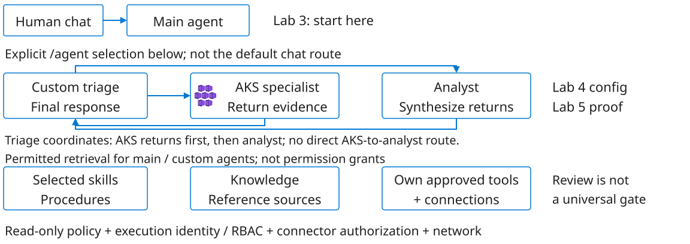

# Signals become evidence in context

Observability connects a service's behavior to evidence about its internal state.

1. **Metrics describe patterns.** Rates, errors and saturation show change over time.
2. **Logs describe events.** Workload context and timestamps connect individual observations.
3. **Evidence has provenance.** Executed reads, sources and sample times support a claim.
4. **Every signal has limits.** Running pods do not prove successful customer orders.

Lab 3 establishes the telemetry baseline before agent creation in Lab 4. Missing samples are unknown, not zero; agreement depends on scope, time and units.

<!--
TIME: 90 seconds.
Lab 3 occupies 13:15-14:00; this introduction uses three and a half minutes within it. Observability is the ability to reason about internal behavior from emitted signals, not simply the presence of a dashboard. Metrics summarize change over intervals; logs preserve individual events and context. Low CPU can coexist with failed orders, and a running pod can still serve errors. Evidence becomes useful when target, UTC sample window, source, units and aggregation are known. A suggested query is not a result: executed reads establish what was observed. Grafana provides the human telemetry baseline before participants create SRE Agent in Lab 4. Later agent comparisons need their own tools, identity and executed-read evidence. Agreement depends on aligned scope and time. The lab develops the distinction between observation, supported inference and an unanswered question.
-->

---

# Where the answer comes from

<figure>

<figcaption>Workshop logical architecture, focused from the full diagram. Configured intent, not runtime proof.</figcaption>
</figure>

<a href="../../diagrams/sre-agent-architecture.svg">Full-size architecture</a> | <a href="../../exercises/sre-agent-architecture.md">Guide</a> | <a href="../../exercises/labs/03-observability.md">Lab 3</a>

<!--
TIME: 120 seconds.
This is a workshop logical architecture, not measured runtime topology or a supplied running agent. After creation in Lab 4, main-agent chat and explicitly selected custom agents are separate entry points. Triage receives AKS specialist evidence, requests analyst synthesis and owns the final response. Human role calls remain MANUAL HANDOVER unless runtime Task or handoff traces demonstrate automation. Skills supply procedures; knowledge supplies references. Neither grants permission or proves loading. Execution identity, authorization, network reachability and tool policy are independent prerequisites. Grafana's identity differs from the agent identity. Review covers supported approval paths; it is not a universal gate. Lab 5 distinguishes saved configuration from demonstrated reads, retrieval, delegation and denials. The full-size diagram adds routes and identity detail without claiming that any path has executed.
-->